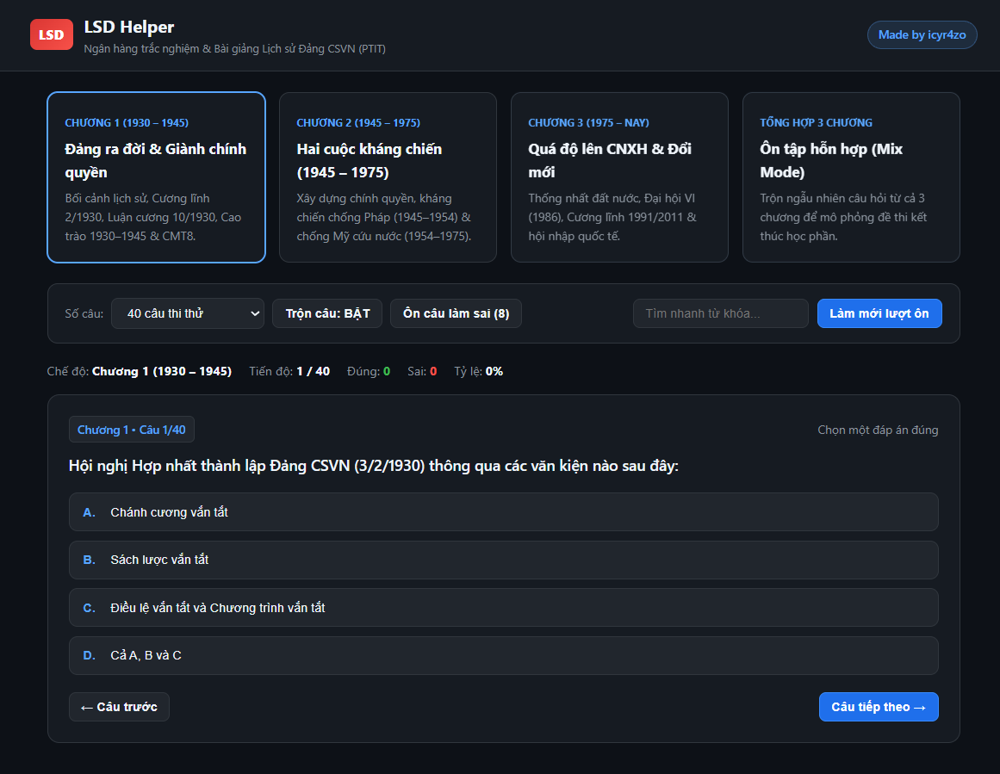

# 🌙 LSD Helper — Ứng dụng ôn tập Lịch sử Đảng Cộng sản Việt Nam

**LSD Helper** là ứng dụng hỗ trợ học tập và ôn luyện trắc nghiệm môn *Lịch sử Đảng Cộng sản Việt Nam*, giúp sinh viên hệ thống hóa kiến thức, ghi nhớ các sự kiện lịch sử quan trọng và tự kiểm tra mức độ hiểu bài.

Không cần đăng ký tài khoản hay cài đặt phần mềm, bạn có thể truy cập ứng dụng ngay trên trình duyệt và bắt đầu ôn tập.

  

---

## ✨ Tính năng nổi bật

### 📚 Ôn tập theo từng chương

Lựa chọn nội dung muốn ôn tập theo chương:

| Chế độ | Nội dung |
|---|---|
| **Chương 1 (1930–1945)** | Đảng ra đời và lãnh đạo đấu tranh giành chính quyền |
| **Chương 2 (1945–1975)** | Kháng chiến chống thực dân Pháp và đế quốc Mỹ |
| **Chương 3 (1975–nay)** | Cả nước quá độ lên CNXH và công cuộc Đổi mới |
| **Mix Mode** | Ôn tập tổng hợp câu hỏi từ cả ba chương |

### 🎯 Tùy chỉnh số lượng câu hỏi

Chủ động lựa chọn số câu trong mỗi lượt ôn tập:

- 20 câu — Ôn tập nhanh.
- 40 câu — Luyện tập thông thường.
- 60 câu — Ôn tập chuyên sâu.
- Tất cả câu hỏi — Luyện tập toàn bộ ngân hàng câu hỏi.

### 💡 Giải thích đáp án sau mỗi câu

Sau khi lựa chọn đáp án, ứng dụng sẽ:

- Thông báo câu trả lời đúng hoặc sai.
- Hiển thị đáp án chính xác.
- Cung cấp phần giải thích kiến thức liên quan.

Giúp bạn không chỉ biết đáp án mà còn hiểu nội dung cần ghi nhớ.

### 🔄 Ôn tập lại câu trả lời sai

Không cần ghi chép thủ công những câu đã làm sai:

- Tự động lưu câu hỏi trả lời sai.
- Có thể xem lại danh sách câu hỏi sai.
- Luyện tập lại để củng cố kiến thức.
- Tự động loại khỏi danh sách ôn sai khi trả lời đúng.

*Lưu ý: Dữ liệu câu sai được lưu trên trình duyệt bằng LocalStorage. Dữ liệu không tự đồng bộ giữa các thiết bị hoặc trình duyệt khác nhau.*

### 🔀 Trộn câu hỏi ngẫu nhiên

Bật hoặc tắt chế độ trộn câu hỏi để thay đổi thứ tự câu hỏi giữa các lượt luyện tập, giúp hạn chế việc ghi nhớ theo thứ tự cố định.

### 🔎 Tìm kiếm câu hỏi

Nhập từ khóa để nhanh chóng tìm những câu hỏi có nội dung liên quan, thuận tiện khi muốn ôn tập một chủ đề cụ thể.

### 🌙 Giao diện Night Mode

- Giao diện tối hiện đại, dễ quan sát.
- Bố cục rõ ràng, thao tác đơn giản.
- Hiển thị tiến độ, số câu đúng, số câu sai và tỷ lệ chính xác.
- Tương thích với nhiều kích thước màn hình.

---

## 🚀 Bắt đầu sử dụng

### 1. Truy cập ứng dụng

Mở đường dẫn:

**👉 https://icyr4zo.github.io/LSD-Helper/**

### 2. Chọn chương muốn ôn tập

Chọn một trong ba chương hoặc Mix Mode nếu muốn luyện tập tổng hợp.

### 3. Thiết lập lượt ôn tập

- Chọn số lượng câu hỏi.
- Bật hoặc tắt chế độ trộn câu.
- Sử dụng ô tìm kiếm nếu muốn tìm câu hỏi theo từ khóa.

### 4. Bắt đầu làm bài

Đọc câu hỏi, chọn một trong bốn đáp án A, B, C, D. Sau khi trả lời, bạn sẽ thấy kết quả và phần giải thích.

### 5. Ôn lại câu sai

Nhấn **Ôn câu làm sai** để luyện tập lại những câu bạn chưa trả lời chính xác.

---

## 🖥️ Giao diện ứng dụng

  

---

## 🛠️ Công nghệ sử dụng

| Công nghệ | Vai trò |
|---|---|
| HTML5 | Xây dựng cấu trúc giao diện |
| CSS3 | Thiết kế giao diện Night Mode |
| JavaScript | Xử lý câu hỏi, đáp án và chức năng luyện tập |
| JSON | Lưu trữ ngân hàng câu hỏi |
| LocalStorage | Lưu các câu hỏi trả lời sai trên trình duyệt |
| GitHub Pages | Triển khai ứng dụng trực tuyến |

---

## 📌 Một số lưu ý

- Ứng dụng miễn phí và không yêu cầu đăng nhập.
- Nên sử dụng trình duyệt hiện đại như Chrome, Edge hoặc Firefox.
- Khi sử dụng bản trực tuyến, cần có kết nối Internet để tải ứng dụng và ngân hàng câu hỏi.
- Dữ liệu câu hỏi được tải từ file `questions.json`.
- Các câu hỏi đã làm sai được lưu trên trình duyệt hiện tại; xóa dữ liệu trình duyệt có thể làm mất danh sách này.
- Nội dung giải thích có mục đích hỗ trợ ôn tập, bạn nên kết hợp với giáo trình và tài liệu học tập chính thức.

---

## 👨‍💻 Developer

**icyr4zo**

- GitHub: [https://github.com/icyr4zo](https://github.com/icyr4zo)
- Repository: [LSD-Helper](https://github.com/icyr4zo/LSD-Helper)

Nếu thấy ứng dụng hữu ích, đừng quên để lại một ⭐ cho repository nhé!

---

  <b>🌙 LSD Helper</b> 
  <i>Ôn tập dễ dàng hơn — Ghi nhớ hiệu quả hơn — Tự tin trước kỳ thi.</i>

